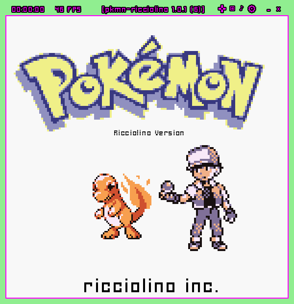
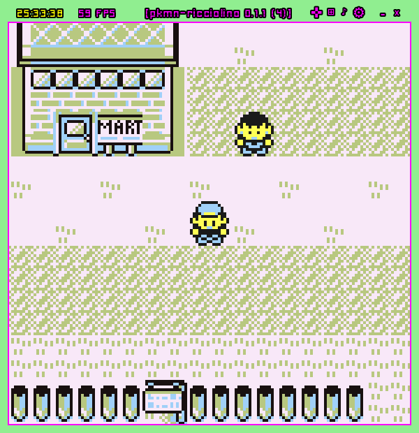
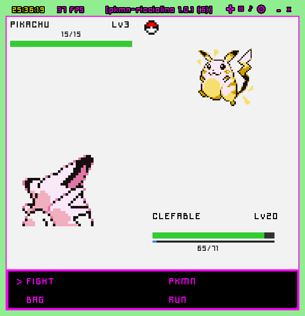
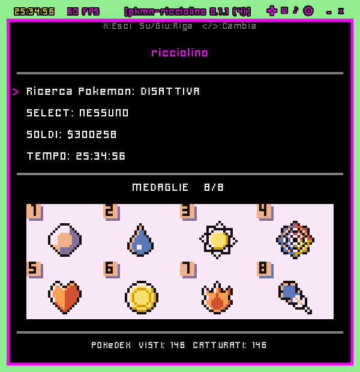

# pkmn-ricciolino

<p align="center">
  
</p>

A from-scratch remake of the first-generation Game Boy Pokémon games, built in Godot.
It is a **Red + Blue fusion**, rebuilt tile by tile so that the whole Pokédex can be
completed in a single playthrough — plus a few liberties of my own.

<p align="center">
  
  
  
  
</p>

---

## Downloads

| Platform | How to get it |
|---|---|
| **Linux desktop** | One command — see [below](#installing-on-linux). Or take the binary straight from [Releases](../../releases) |
| **Android** | [Releases](../../releases) — APK, sideload it |
| **iOS / iPadOS** | **On request.** Email **ricciolinotop@gmail.com** to be added to the TestFlight internal testing group. There are no plans to put it on the App Store |

> **This repository holds only the builds.** The source lives in a separate repository,
> private for the moment — I still have things I want to try on it, some of them fairly
> odd, and I'd rather get them in before opening the code to the world.
>
> It won't stay closed. The plan is to publish it eventually: partly for the fun of it,
> partly because a project like this is a decent thing to learn from, or to build a
> tutorial around.
>
> In the meantime, if you'd like to collaborate on something, write to
> **ricciolinotop@gmail.com** — same address as above.

---

## Installing on Linux

The game is one self-contained binary, so you *can* just download it and run it. The
installer exists because a binary alone gives you no menu entry, no icon, and nothing to
uninstall later.

```bash
curl -fsSL https://raw.githubusercontent.com/ricciolino/pkmn-ricciolino-releases/main/install-linux.sh | bash
```

Piping a script into a shell is a habit worth questioning, so: the script is right there in
this repository — [`install-linux.sh`](install-linux.sh). Download it, read it, then run it.

**What it does.** It asks the GitHub API for the latest release, downloads the Linux build,
**verifies its SHA-256 against the checksum published with the release**, and installs four
things — no `sudo`, nothing outside your home directory:

| | |
|---|---|
| `~/.local/bin/pkmn-ricciolino` | the game |
| `~/.local/share/icons/hicolor/256x256/apps/` | the icon |
| `~/.local/share/applications/` | the menu entry, with an *Uninstall* action |
| `~/.local/bin/pkmn-ricciolino-uninstall` | the uninstaller |

Run it again later and you get the newest release in place of the old one.

**Uninstalling:**

```bash
~/.local/bin/pkmn-ricciolino-uninstall
```

It removes those four files and **leaves your saves alone**, in
`~/.local/share/godot/app_userdata/pkmn-ricciolino/`.

### What it needs, and what it doesn't

- **x86_64 with glibc.** No ARM, and not musl systems such as Alpine. The script checks the
  architecture and stops with a clear message rather than installing something that cannot run.
- **`curl`.** Nothing else — no `jq`, no Python, no package manager.
- **A desktop that reads XDG entries** for the menu icon: GNOME, KDE, XFCE, Cinnamon and the
  rest. Bare window managers — i3, sway, dwm — don't read `.desktop` files themselves, but
  launchers like `rofi -show drun` and `dmenu_run` do. Either way the game runs from the
  terminal.
- If `~/.local/bin` isn't on your `PATH`, the script says so and tells you the full path
  instead of leaving you with a command that isn't found.

The desktop entry and the icon are kept in [`linux/`](linux/) in this repository, versioned
alongside the installer — so you can see exactly what will be put on your system before you
run anything.

---

## What this is

As a kid I never had a Game Link cable, so my Pokédex always stopped a few entries short —
the trade evolutions were simply out of reach. Building a version that one person could
finish alone has been a small dream of mine ever since.

Red and Blue were built to be incomplete: each cartridge was missing creatures the other
one had, and the only way to fill the gap was that cable and a friend with the other
version.

So here it is, rebuilt from nothing. Not a ROM hack and not a patch: a
**remake written from scratch** in Godot — its own engine code, its own maps, its own
battle system — with one decision at the centre of it: **one player, one copy, one complete
Pokédex.** Every species obtainable somewhere, trade evolutions included, without ever
needing a second console.

The look stays faithful on purpose: the Game Boy palettes, the text boxes, the Gen 1 battle
maths down to the critical-hit formula. What changed is what had to change for a single
player to see all of it.

### …and one more thing

There is a **152nd creature**, designed by me, that is not in the original Pokédex.

It cannot be caught normally. The only way in is a **glitch I put there on purpose** — and
you can work out that it exists from the very first minutes of the game, if you are paying
attention to everything. Especially to one particular line of dialogue. 👀

---

## Honest notes before you play

This is a remake made by one person, and some things are deliberately not identical to the
cartridge. None of them affect how the game plays, but you will notice them:

- **Grass tufts don't sway**, and the **sea doesn't ripple** — the world is drawn, not
  animated. Ambient tile animation is simply not implemented.
- **Move animations are simplified.** Every move works, with its real Gen 1 behaviour, but
  the effects on screen are not a frame-by-frame reproduction of the original.
- **Not every sound matches.** Music and effects were rebuilt and re-tuned by ear; some are
  very close, some are an interpretation.
- **A few personal liberties.** Where Gen 1 had a famous bug that would simply read as *my*
  bug to anyone playing today, I fixed it instead of preserving it.

Everything else — the story from Pallet Town to the Hall of Fame, the eight badges, the
Elite Four, the post-game — is there and finished.

---

## Under the hood

| | |
|---|---|
| **Engine** | Godot **4.4.1**, Compatibility renderer (OpenGL) |
| **Language** | GDScript |
| **Resolution** | 150×155 px viewport, 144×144 play area, 16 px tiles, nearest-neighbour |
| **Content** | 220 maps · 152 species · 177 moves · full EN/IT localisation |
| **Input** | Keyboard, touch and USB gamepad — every feature works on all three |
| **Platforms** | Linux desktop, Android, iOS |

Builds are produced **by hand, on my own machines** — no CI, no hosted runners. Each
release is tagged, and the tag carries its own notes.

---

## Reporting something

Found a bug, a wrong name, a wall you can walk through? Open an
[issue](../../issues) and say which version you are on — the game shows it in the top bar
and in **Options → About**, in the form `1.0.0 (5)`.

---

## Credits and legal

Pokémon, Pokémon Red and Pokémon Blue are trademarks of Nintendo, Creatures Inc. and
GAME FREAK Inc. This is a **non-commercial fan project**, built for the pleasure of
building it, and is not affiliated with or endorsed by any of them. No original game data
is distributed here.
